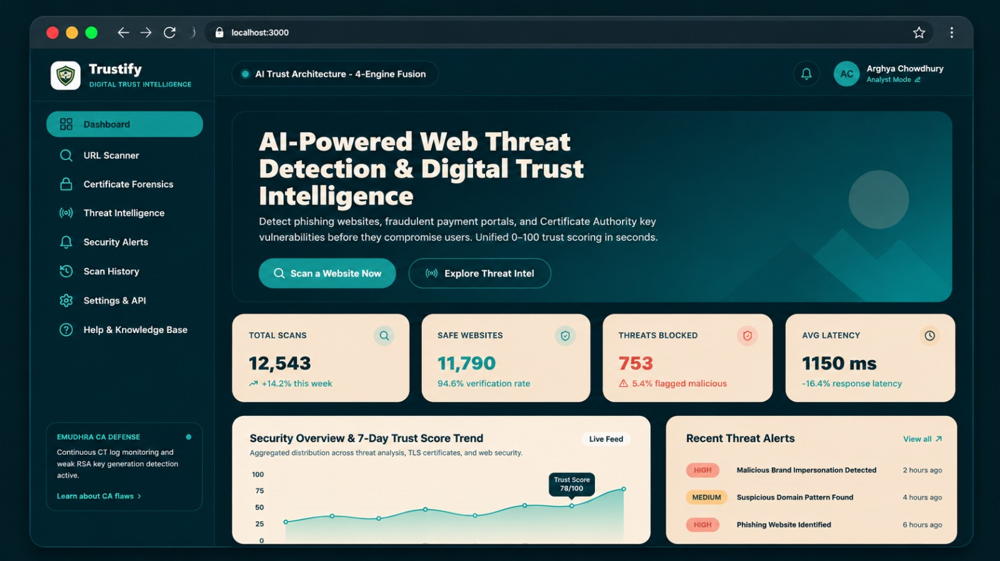

<p align="center">
  
</p>

<h1 align="center">🛡️ Trustify</h1>

<h3 align="center">AI-Powered Web Threat Detection & Digital Trust Intelligence</h3>

<p align="center">
  <em>Detect · Analyze · Stay Safe</em>
</p>

<p align="center">
  
  
  
  
  
  
</p>

<p align="center">
  <a href="https://trustify-hackmatrix.vercel.app/" target="_blank">
    
  </a>
  <a href="https://github.com/arghachowdhury2006-gif/Trustify" target="_blank">
    
  </a>
</p>

<p align="center">
  <a href="https://trustify-hackmatrix.vercel.app/" target="_blank"><b>🚀 Live Demo</b></a> •
  <a href="#features"><b>Features</b></a> •
  <a href="#architecture"><b>Architecture</b></a> •
  <a href="#quick-start"><b>Quick Start</b></a> •
  <a href="#api"><b>API</b></a> •
  <a href="#team"><b>Team</b></a>
</p>

---

<p align="center">
  
  <br />
  <em>Trustify – AI-Powered Digital Trust Intelligence Dashboard</em>
</p>

---

<a id="demo"></a>

## 🌐 Live Demo & Overview

### 🚀 Try Trustify Online

**Live Application:** https://trustify-hackmatrix.vercel.app/

Trustify is an intelligent web security platform that helps identify phishing websites, fraudulent recruitment and payment portals, deceptive domain impersonation, and Certificate Authority (CA) trust infrastructure vulnerabilities.

It combines multiple security inspection engines to provide an explainable digital trust assessment.

### Key Highlights

- **Interactive Security Dashboard:** Access the deployed security dashboard.
- **Real-Time URL Analysis:** Analyze website URLs for potential threats.
- **Certificate Validation:** Inspect TLS certificates and certificate-related security issues.
- **Web Security Assessment:** Evaluate security headers and cookie configurations.
- **Threat Intelligence:** Explore community-submitted threat reports.
- **Local Application Access:** `http://localhost:3000`

> Note: Some features may depend on API credentials and backend service availability.

---

<a id="features"></a>

## 🌟 Core Features & Architectural Engines

Trustify combines multiple security inspection engines into an explainable **0–100 Digital Trust Score**.

### 1. Threat Analysis Engine (ML & Heuristics)

- Brand lookalike and typosquatting detection using Levenshtein distance and phonetic/homoglyph character substitution (e.g. `paypa1`, `micros0ft`, `bank0famerica`).
- Lexical URL feature extraction: Shannon entropy, subdomain depth, suspicious TLDs, Punycode/IDN attacks, `@` credentials deception, and raw IP address hostnames.
- HTML DOM analysis: password forms submitting to external domains, obfuscated JavaScript payloads (`eval`, `unescape`, `atob`), and missing security attributes.

### 2. Certificate Validation & CT Forensics Engine

- Cryptographic TLS chain validation: leaf, intermediate, and root trust anchors.
- Detection of expired certificates, self-signed chains, hostname mismatches, weak keys (`RSA < 2048` or `EC < 256`), and deprecated `SHA-1` signatures.
- **eMudhra CA Weak-Key Heuristics:** Automated small-prime trial division on RSA moduli, duplicate SPKI public key detection across unrelated domains, and ROCA vulnerability tests.
- **Certificate Transparency Monitoring:** Public `crt.sh` timeline extraction and alerting on anomalous or unexpected certificate authorities.

### 3. Web Security Assessment Engine (Passive Only)

- Security headers audit: `Strict-Transport-Security` (HSTS), `Content-Security-Policy` (CSP), `X-Frame-Options`, `X-Content-Type-Options`, `Referrer-Policy`, and `Permissions-Policy`.
- Cookie security validation: `Secure`, `HttpOnly`, and `SameSite` flags.
- Cleartext HTTP-to-HTTPS redirect verification and server technology version disclosure detection.
- Strictly passive inspection: no active exploitation or port scanning.

### 4. Collaborative Threat Intelligence Network

- Community-submitted threat reports with category tags (Phishing, Fake Payment, Fake Job Portal, Impersonation).
- Peer voting (upvoting/downvoting) and dynamic analyst reputation scoring.
- Indicators of Compromise (IOC) export in **CSV**, **JSON**, and **STIX 2.1** formats.

### 5. SSRF Guard Protection

- Protection against Server-Side Request Forgery.
- Blocks loopback (`127.0.0.0/8`), RFC1918 private subnets, link-local cloud metadata endpoints (`169.254.169.254`), CGNAT, and IPv6 mappings.
- Independent DNS resolution and pinned transport.

---

<a id="architecture"></a>

## 🧭 Architecture & System Design

```text
                     ┌───────────────────────────────────────────────┐
                     │       Next.js 14 Frontend & Client UI        │
                     │   App Router · Tailwind CSS · shadcn/ui      │
                     └───────────────────────┬───────────────────────┘
                                             │ HTTPS / REST API & SSE Events
                                    ┌────────▼────────┐
                                    │ Next.js API / GW│  Auth · SSRF Guard · Rate Limit
                                    └───┬─────────┬───┘
                                        │         │
                  ┌─────────────────────┼─────────┴─────────────────────┐
                  │                     │                               │
         ┌────────▼────────┐   ┌────────▼────────┐             ┌────────▼────────┐
         │  Threat Engine  │   │   Cert Engine   │             │  WebSec Engine  │
         │  ML Heuristics  │   │  TLS / CT Logs  │             │ Security Headers│
         └────────┬────────┘   └────────┬────────┘             └────────┬────────┘
                  │                     │                               │
                  └─────────────────────┼───────────────────────────────┘
                                        │
                               ┌────────▼────────┐
                               │  Intel Engine   │
                               │ Community Feeds │
                               └────────┬────────┘
                                        │
                          ┌─────────────▼─────────────┐
                          │   0–100 Trust Score Agg   │
                          │ Safe | Suspicious | Alert │
                          └───────────────────────────┘
```

---

## 📐 Scoring Formula & Verdicts

Trustify uses the following weighted risk formula:

$$\text{Risk} = 0.40 \times \text{ThreatRisk} + 0.25 \times \text{CertRisk} + 0.20 \times \text{WebSecRisk} + 0.15 \times \text{IntelRisk}$$

$$\text{Score} = \max(0, \min(100, 100 - \text{Risk}))$$

### Risk Classification

- **Safe (≥ 80):** Valid TLS certificates, secure headers, reputable domain history, and zero phishing indicators.
- **Suspicious (50–79):** Configuration anomalies, expiring certificates, or newly registered infrastructure.
- **Malicious (< 50):** Strong indicators such as brand impersonation, threat intelligence matches, or credential-harvesting forms.

---

<a id="quick-start"></a>

## 🚀 Quick Start

### 🌍 Option 1: Use the Live Application

No local installation required.

Visit:

**https://trustify-hackmatrix.vercel.app/**

### 💻 Option 2: Run Locally

#### 1. Clone the Repository

```bash
git clone https://github.com/arghachowdhury2006-gif/Trustify.git

cd Trustify
```

#### 2. Install Dependencies

```bash
npm install
```

#### 3. Configure Environment Variables

Create a `.env.local` file in the project root and add the required API keys.

```env
GOOGLE_SAFE_BROWSING_KEY=your_google_safe_browsing_api_key
VIRUSTOTAL_API_KEY=your_virustotal_api_key
WHOIS_API_KEY=your_whois_api_key
```

Use the actual environment variable names required by your application.

**Important:** Never commit real API keys or secrets to GitHub.

#### 4. Start the Development Server

```bash
npm run dev
```

Open your browser:

```text
http://localhost:3000
```

#### 5. Production Build

```bash
npm run build
npm start
```

---

## 🧪 Quick Test Scenarios

Try these test targets directly in the UI or via API:

| URL / Target | Expected Verdict | Primary Reason Codes |
|---|---|---|
| `https://paypa1-secure-login.com/auth/verify` | ✖ **Malicious** (Expected test scenario) | `BRAND_LOOKALIKE`, `NEW_DOMAIN_LT_30D`, `LOGIN_FORM_OFFDOMAIN` |
| `https://expired.badssl.com` | ⚠ **Suspicious** | `EXPIRED` (Certificate expired) |
| `https://self-signed.badssl.com` | ⚠ **Suspicious** | `SELF_SIGNED` (Untrusted authority) |
| `https://example.com` | ✔ **Safe** (Expected test scenario) | Security checks should be evaluated by the application |
| `http://169.254.169.254/latest/meta-data` | 🛑 **Blocked** (Expected SSRF protection) | `SSRF_BLOCKED` |

> These are testing scenarios, not guarantees of the application's current output. Verify the actual results before presenting them as confirmed.

---

<a id="api"></a>

## 🔌 API Reference (`/api/v1`)

| Method | Endpoint | Description |
|---|---|---|
| `POST` | `/api/v1/scans` | Submit a URL for real-time multi-engine scan |
| `GET` | `/api/v1/scans/{id}/events` | Server-Sent Events (SSE) live progress stream |
| `POST` | `/api/v1/certificates/check` | Inspect TLS certificate, chain, and eMudhra weak-key heuristics |
| `GET` | `/api/v1/certificates/ct/{domain}` | Certificate Transparency audit trail from crt.sh |
| `GET` | `/api/v1/intel/feed` | Collaborative threat reports feed |
| `POST` | `/api/v1/intel/reports` | Submit a community threat report |
| `POST` | `/api/v1/intel/reports/{id}/vote` | Upvote or downvote a reported threat |
| `GET` | `/api/v1/intel/export?format=csv\|json\|stix` | Export IOCs in CSV, JSON, or STIX 2.1 |
| `GET` | `/api/v1/public/check?url=` | High-speed cache-first check for extensions and AI agents |
| `GET` | `/api/v1/dashboard/summary` | Executive KPIs, donut ratios, and 7-day trend |
| `GET` | `/api/v1/health` | Service health status and engine status |

---

## 🤖 Model Context Protocol (MCP) Server

Connect Trustify to an MCP-compatible AI agent (Claude, Antigravity, Cursor):

```bash
# Start MCP server
python mcp/fraudguard_mcp/server.py
```

### Tools Provided

- `scan_url(url, deep)`
- `check_certificate(host, port)`
- `report_threat(url, category, description)`
- `get_trending_threats(window)`

---

## 🎨 UI/UX Design System

| Color | Hex Code | Usage |
|---|---|---|
| Deep Teal | `#213843` | Sidebar, app background, primary text |
| Teal | `#468D8B` | Primary buttons, active tabs, Safe status |
| Soft Teal | `#74B3A8` | Highlights, charts, subtle accents |
| Warm Cream | `#F6DAC0` | Card surfaces |
| Soft Cream | `#FBEBDA` | Inputs and nested cards |
| Peach | `#FEAF76` | Suspicious / medium severity |
| Coral | `#DA6D58` | Malicious / high severity |

---

<a id="team"></a>

## 👥 Meet Our Team

| Number | Team Member | GitHub Profile |
|:---:|---|---|
| 1 | **Sibsankar Maity** | [@oii-siba](https://github.com/oii-siba) |
| 2 | **Arghya Chowdhury** | [@arghachowdhury2006-gif](https://github.com/arghachowdhury2006-gif) |
| 3 | **Sujan Bhowmik** | [@sujanbhowmik12](https://github.com/sujanbhowmik12) |
| 4 | **Sayan Pattanayak** | [@sayan3239](https://github.com/sayan3239) |

---

## 📄 License

This project is licensed under the MIT License.

---

<p align="center">
  <b>Built with innovation, teamwork & passion ❤️</b>
  <br />
  HackMatrix 2026
  <br /><br />
  <a href="https://trustify-hackmatrix.vercel.app/">
    <b>🚀 Explore Trustify Live</b>
  </a>
</p>

---

## ⚖️ Responsible Use Policy

Trustify is designed for **defense, validation, and threat mitigation**.

All scans are intended for passive security inspection. No exploit payloads, unauthorized port scans, or intrusive attacks are intended to be performed.
